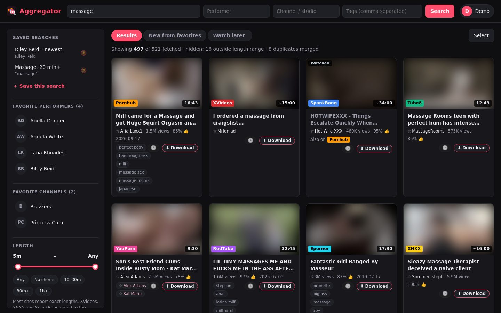
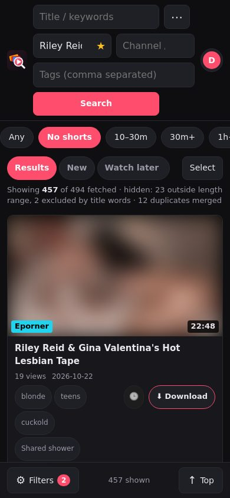
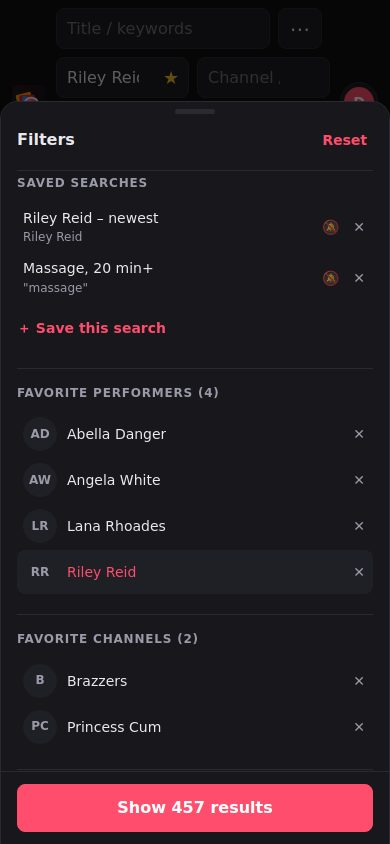
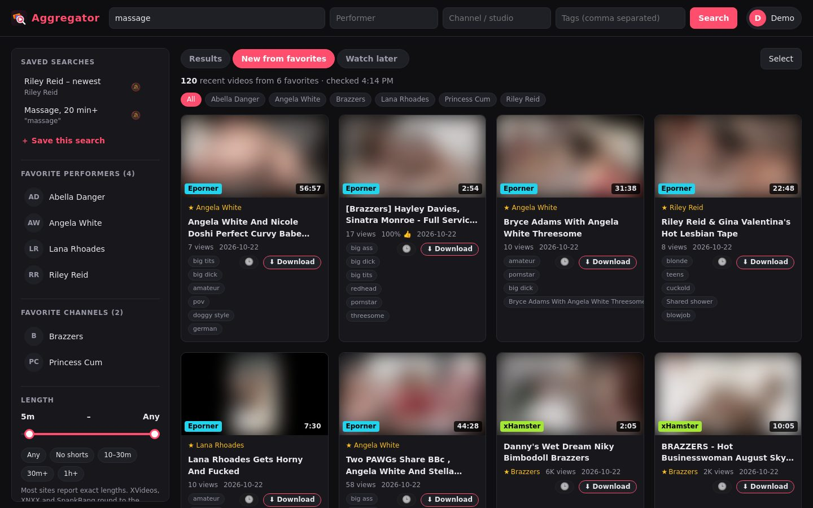
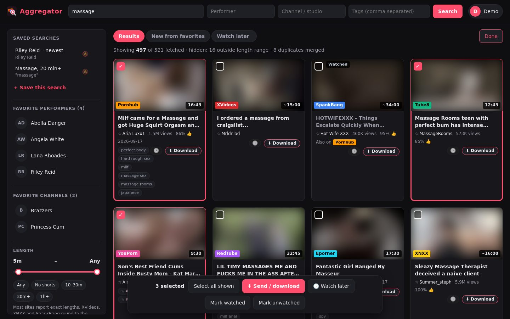
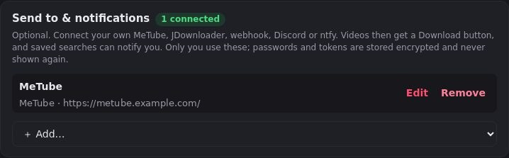
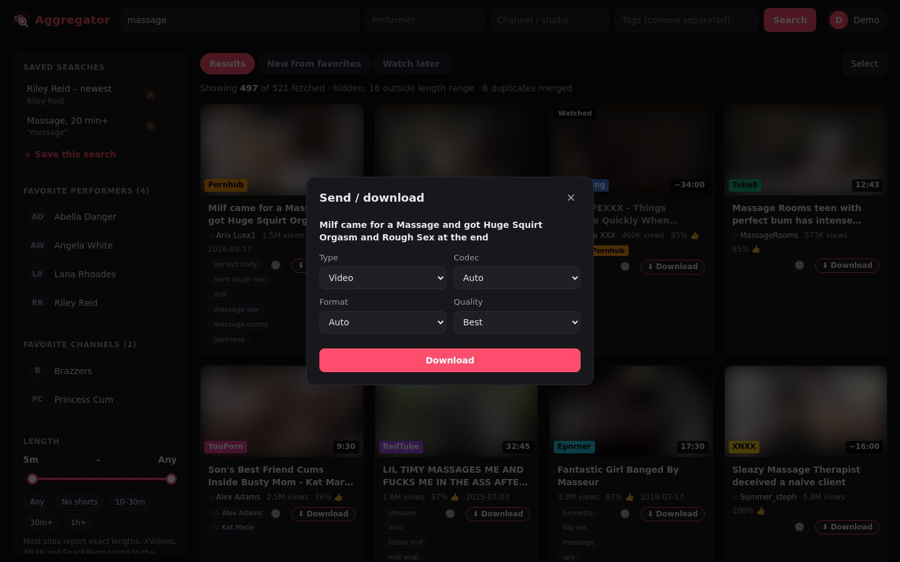
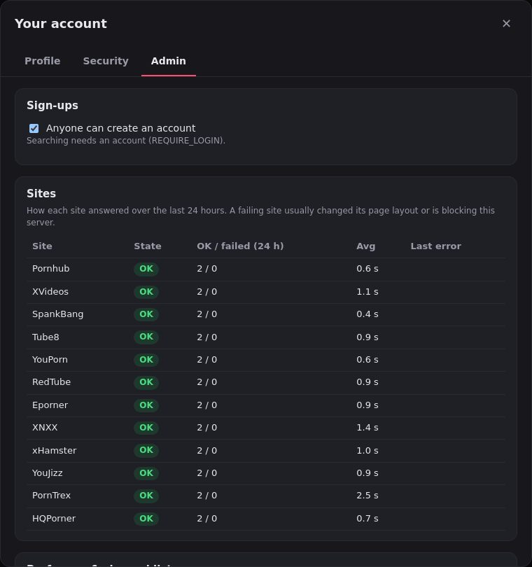

# Naughty Site Aggregator


One search page across twelve free tube sites: Pornhub, XVideos, SpankBang, Tube8, YouPorn,
RedTube, Eporner, XNXX, xHamster, YouJizz, PornTrex and HQPorner. It fetches **metadata only**
(titles, lengths, thumbnails, links). It never downloads or re-hosts any video.
Videos play in each site's own embed player, or open on the site.



<p align="center">
  
  &nbsp;
  
</p>

<sub>Thumbnails in these screenshots are blurred on purpose; the app shows each site's real thumbnails.</sub>

## Run

```bash
docker run -d -p 3160:8000 --restart unless-stopped ghcr.io/yo-repo87/naughty-site-aggregator:latest
# or build locally:
docker compose up -d --build     # http://<host>:3160
# or, without Docker:
./run.sh                         # http://localhost:8000
```

## Performer and channel suggestions

The Performer and Channel / studio boxes are also dropdowns, like Pornhub's search suggestions:
click one to scroll through every performer (about 21,000) or channel (about 2,800), most popular
first, with each one's picture, video count and the sites that list them. Type to narrow the list;
picking a name runs the search. The lists come from Pornhub's full performer and channel
directories plus the most popular pages of xHamster's and XVideos'. They are rebuilt daily and
cached in `/data` (mount a volume there to keep them across updates). Free text still works for
names that aren't listed.

## Favorites and the "New from favorites" feed

Star a performer or a channel (☆) in its dropdown, in the box itself, or on a video card (the
performer chip or the channel name). Favorites head the dropdowns and are listed in the filters
panel; one click searches them.

The **New from favorites** tab collects the newest videos of every favorite from the sites that
can sort newest-first (Pornhub, XVideos, xHamster, YouPorn, RedTube, Eporner, PornTrex). The
server looks each name up in the background (every `FEED_REFRESH_HOURS`, default 6) and shares the
result between everyone who favorited it; the tab shows a badge with how many arrived since you
last looked. Filter the feed by favorite with the chips above it.



## Your library

- **Watch later:** 🕒 on a card saves it to the Watch later tab (up to 300).
- **Watched:** videos you opened are dimmed and marked; tick *Hide videos I've watched* to drop them.
- **Select mode:** *Select* turns cards into checkboxes; the bar at the bottom sends up to 50 at once,
  adds them to Watch later or marks them watched / unwatched.
- **Saved searches:** *＋ Save this search* keeps the keywords, performer, channel, tags, length,
  sites and sort; one tap runs it again. 🔔 turns on an **alert**: the server re-runs it every
  `ALERT_HOURS` (default 6) and notifies you through ntfy, Discord or a webhook when new videos appear.
- **Block:** performers and tags you never want to see (channels: ✕ in the Channels list).
- **Duplicates:** the same upload on several sites (Pornhub, YouPorn, Tube8 and RedTube share a
  catalogue) becomes one card with "Also on …" buttons; untick *Merge the same video across sites*
  to see them separately.
- **Newest first:** a sort option; sites that can sort that way do it themselves.
- The address bar always names the current search (e.g. `/?actor=Riley+Reid&sort=new`), so it can
  be bookmarked or shared and survives a reload.

All of this is saved with the other settings: in the browser and, when signed in, synced (encrypted)
to the account.



## Send to & notifications (optional, per account)

In **Account → Profile → Send to & notifications** each user can connect their own:

| Destination | What it does |
|---|---|
| [MeTube](https://github.com/alexta69/metube) | Downloads the video, with MeTube's Type / Codec / Format / Quality choices; cards then show its progress (queued, downloading %, downloaded, failed). |
| JDownloader 2 | Adds the link to the link grabber via Click'n'Load (port 9666). |
| Webhook | POSTs JSON to any URL (n8n, Home Assistant, a script); optional auth header. Also receives alerts. |
| Discord | Posts the link to a channel webhook. Also receives alerts. |
| ntfy | Push notification (ntfy.sh or self-hosted, optional token). Also receives alerts. |



Saving tests the connection first. Once something that takes videos is connected, every video gets
a **Download** button (and select mode a *Send* button).


 Secrets (passwords, tokens, the Discord
webhook URL) are stored encrypted and never sent back to the browser; leaving one blank when editing
keeps it only while the address stays on the same server.

The server makes these requests itself, so destinations can be plain HTTP. Because anyone who can
register could make it contact an address, it only connects to public addresses, never follows
redirects, and pins the connection to the address it checked; a destination on your LAN must be
listed in `SEND_PRIVATE_HOSTS`. Only video pages of the supported sites can be sent.

## Admin page

Accounts whose email is listed in `ADMIN_EMAILS` get an **Admin** tab: all accounts (sign them out
or delete them), a switch for open sign-ups (overrides `ALLOW_REGISTRATION`), each site's health over
the last 24 hours (successes, failures, speed, last error), the performer/channel lists (with
*Rebuild now*), the background jobs, and the plug-ins that loaded or failed.



## Plug-ins

Extra sites and extra "Send to" destinations can be added without rebuilding the image: put Python
files in `plugins/sources/` or `plugins/targets/` (mounted at `/plugins`) and restart. A plug-in with
the same name as a built-in site replaces it — handy when a site changes its layout. Templates and
instructions are in [`plugins-example/`](plugins-example/). Plug-ins run inside the server with full
access to it: only install code you trust.

## Phones and tablets

Phones, tablets (touch without a mouse) and narrow windows get a mobile layout automatically;
desktops keep the sidebar layout. The mobile layout has a compact search bar (⋯ opens
performer / channel / tags), swipeable length chips, filters in a slide-up sheet, a bottom bar,
infinite scroll, a full-screen player, Back-button support, and optional auto-play previews.
It is installable ("Add to Home Screen") and opens like an app.

## Accounts (optional)

Without a database the app is search-only. With one, people can create accounts to sync their
filters, hidden channels and source choices across devices.

- **Sign in:** email + password (Argon2id), **passkeys** (fingerprint / face / device PIN, no
  password), **security keys** (USB/NFC; with their PIN they sign in on their own), and
  **Google / Facebook / Discord** — each button appears only when its keys are configured.
- **Two-step sign-in:** authenticator app (TOTP, replay-protected) or a security key after the
  password, plus 10 single-use backup codes.
- **Security tab** for each user: passkeys, security keys, authenticator app, backup codes,
  password, connected accounts, signed-in devices (sign out remotely) and recent activity.
  Sensitive changes ask you to confirm it's you; you can't remove your last way to sign in.
- **Encryption:** email, name, authenticator secret, provider ids, device/IP info and synced
  settings are AES-256-GCM encrypted (each value bound to its row); email lookups use keyed
  hashes; session tokens and backup codes are stored only as keyed hashes. The database
  connection can require TLS with certificate verification (`DB_SSL=verify-full`). Cookies are
  `__Host-`, `Secure`, `HttpOnly`, `SameSite=Lax`; responses carry HSTS and a strict CSP;
  cross-site requests are refused.

### Configuration (`.env`)

| Variable | Purpose |
|---|---|
| `DATABASE_URL` | Postgres URL. Leave empty for search-only. |
| `DB_SSL` | `disable`, `require` or `verify-full` (recommended). |
| `DB_SSL_ROOT_CERT` | CA/server certificate used by `verify-full`. |
| `DATA_KEY` / `INDEX_KEY` | Two different 32-byte keys, base64url (`python -c "import secrets,base64;print(base64.urlsafe_b64encode(secrets.token_bytes(32)).decode())"`). **Never change or lose them** — encrypted data can't be read without `DATA_KEY`. |
| `PUBLIC_URL` | The public HTTPS address (passkeys, OAuth redirects, secure cookies). |
| `REQUIRE_HTTPS` | `true` redirects any other address to `PUBLIC_URL`. |
| `REQUIRE_LOGIN` | `true` means searching needs an account. |
| `ALLOW_REGISTRATION` | `false` stops new sign-ups. |
| `SEND_PRIVATE_HOSTS` | LAN addresses users may connect as destinations (MeTube, JDownloader, a webhook…), comma-separated `host`, `host:port` or CIDR (e.g. `192.168.1.10:8081`). Empty = public addresses only. Anyone who can register can make the server contact these, so list only what you need. (`METUBE_PRIVATE_HOSTS` still works.) |
| `ADMIN_EMAILS` | Comma-separated emails of accounts that get the Admin tab. |
| `ALERT_HOURS` / `FEED_REFRESH_HOURS` | How often saved-search alerts and the favorites feed are checked (default 6). |
| `PLUGINS_DIR` | Plug-in folder (default `/plugins`). |
| `GOOGLE_CLIENT_ID` / `_SECRET`, `FACEBOOK_…`, `DISCORD_…` | Optional providers. |

Provider redirect URL to register: `<PUBLIC_URL>/api/auth/oauth/<google|facebook|discord>/callback`

- **Google:** Google Cloud Console → APIs & Services → Credentials → OAuth client ID (Web).
- **Facebook:** developers.facebook.com → Create app → Facebook Login → Valid OAuth Redirect URIs.
- **Discord:** discord.com/developers → Applications → OAuth2 → Redirects.

## What each source supports

| Site | How | Performer / tag search | Channel shown | Length filter on the site | Length precision | In-page player |
|---|---|---|---|---|---|---|
| Pornhub | JSON API + HTML search, merged | Real (`stars[]`, `tags[]`) | Yes (HTML hits) | Min 10/20/30 min | Exact | Yes |
| XVideos | HTML | Keywords | Yes | Buckets 1–3, 3–10, 10–20, 10+, 20+ | Minute (~) | Yes |
| SpankBang | HTML (Cloudflare; Chrome-impersonating client) | Keywords | Yes | Min 10/20/40 min | Minute (~) | Yes |
| Tube8 | HTML | Keywords; performers from cards | Yes | Exact min/max minutes (≤60) | Exact | Yes |
| YouPorn | HTML (same platform as Tube8) | Keywords; performers from cards | Yes | Exact min/max minutes (≤60) | Exact | Yes |
| RedTube | JSON API | Real tags (`tags[]`); performer as keyword | No | None | Exact | Yes |
| Eporner | JSON API | Keywords; keyword list shown as tags | No | None | Exact | Yes |
| XNXX | HTML (same platform as XVideos) | Keywords | Creator uploads | Buckets 0–10, 10–20, 10+, 20+ | Minute (~) | Yes |
| xHamster | JSON embedded in the search page | Keywords | Yes | Min/max minutes | Exact | Yes |
| YouJizz | HTML | Keywords | No | None | Exact | No (opens the site) |
| PornTrex | HTML (KVS script) | Keywords | No | Buckets <10, 10–30, 30+ | Exact | Yes |
| HQPorner | HTML (HD-only site) | Keywords (matched against the site's tags) | No | None | Exact | No (opens the site) |

The precise length slider, title-word excludes, channel include/hide and sorting all
run in the browser, so they update as you change them. When you widen the length range
past what the sites were asked for, the app searches again on its own.

Pornhub's newer `pix-*` thumbnails only load with a Pornhub referer, so `/api/thumb`
relays those thumbnail images (allow-listed `phncdn.com` hosts, images only, size-capped).
Videos are never relayed.

## API

`GET /api/search?q=&actor=&channel=&tags=a,b&min_sec=&max_sec=&sources=pornhub,xvideos,...&page=1&pages=2&sort=new`
(`sources` defaults to all; `sort=new` = newest first where the site supports it)

`GET /api/sources` (each site, what it can sort by, plug-in badge colours)
`POST /api/feed` `{performers: [...], channels: [...]}` (recent videos of those favorites)
`POST /api/me/targets/<id>/send` `{video: {url, title, source, duration, thumb}, options}` (signed in)
`GET /api/suggest?kind=performer|channel&q=&offset=0&limit=30` (dropdown entries; empty `q` = everyone by popularity)

## Caveats

- These are scrapers. If a site changes its HTML, its parser in `aggregator/sources/` needs updating.
- Some studio videos turn off embedding. The player then shows "watch on site"; use **Open on site**.
- Pornhub and its sister sites (Tube8, YouPorn, RedTube) are blocked in some regions (several US states, for example). They show as error sources there.
